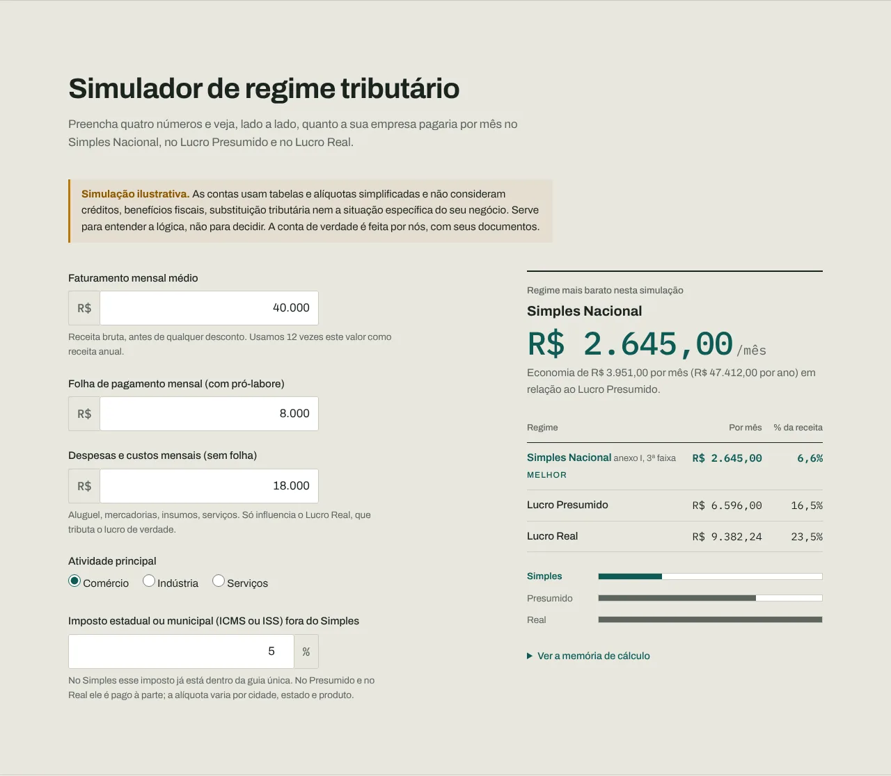
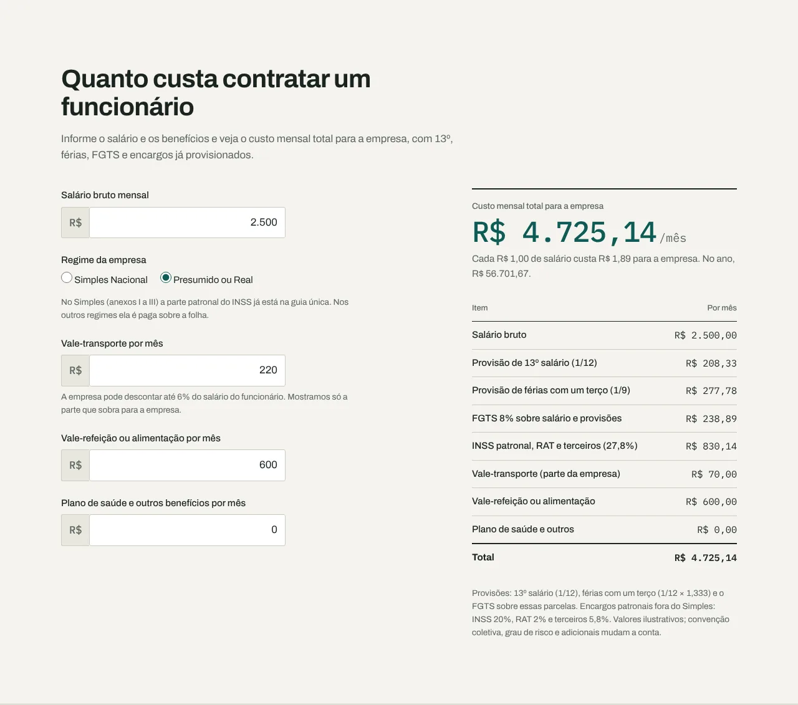
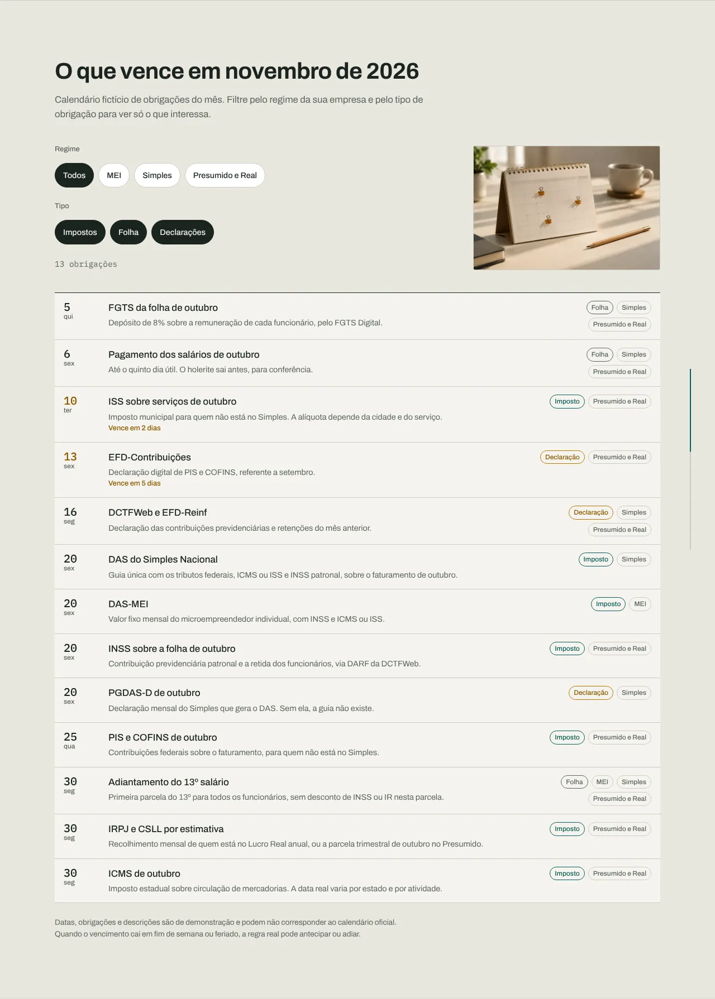
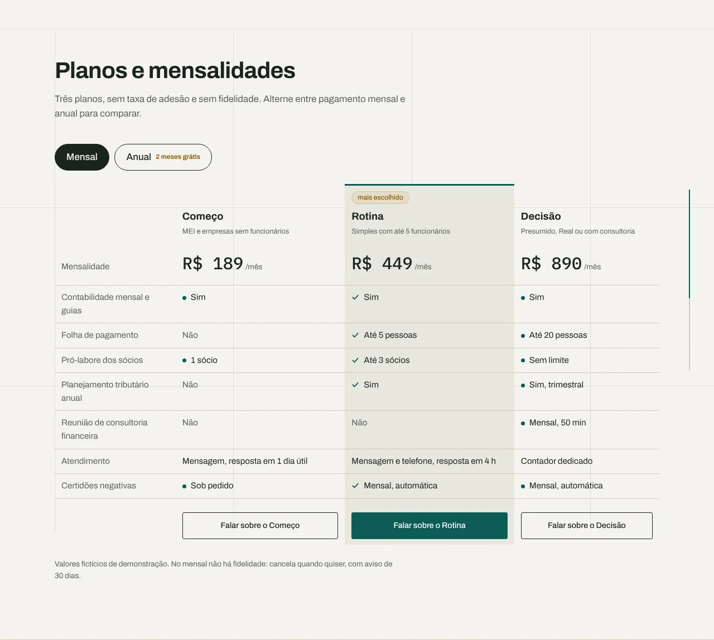

# Lastro Contabilidade

Site de demonstração que eu, Rodrigo Jr, da [Mil e Uma Linhas!](https://mileumalinhas.com.br), fiz para mostrar como pode ser o site de um escritório de contabilidade e consultoria financeira para pequenas empresas.

Endereço: https://toshiro01001.github.io/contabilidade/


## O que é este site, para quem não é da área

É a vitrine de um escritório contábil que não existe, a "Lastro Contabilidade". Ele mostra os serviços, quem seria a equipe, os planos e o jeito de falar com o escritório. E tem quatro ferramentas que funcionam de verdade na sua tela:

1. **Simulador de regime tributário**: você digita faturamento, folha de pagamento, despesas e a atividade da empresa e vê, lado a lado, quanto pagaria por mês no Simples Nacional, no Lucro Presumido e no Lucro Real, com a memória de cálculo aberta para conferir.
2. **Custo de contratar um funcionário**: salário mais 13º, férias, FGTS, encargos e benefícios, com o custo total para a empresa e quanto cada real de salário custa de verdade.
3. **O que vence no mês**: um calendário de obrigações com filtros por regime (MEI, Simples, Presumido e Real) e por tipo (impostos, folha, declarações).
4. **Planos e mensalidades**: tabela comparativa que alterna entre pagamento mensal e anual.

O formulário de contato confere o que você digitou e mostra um resumo na tela, sem enviar nada para ninguém.

## Aviso: tudo é fictício

Empresa, pessoas, CRC, endereço, telefone, depoimentos, preços e datas do calendário são inventados. As contas do simulador e da calculadora são simplificadas e servem para entender a lógica, não para decidir. Nada é vendido, cobrado ou enviado.

## Como usar

1. Abra o endereço acima no computador ou no celular.
2. Role até "Simulador de regime tributário", mude os números e veja o resultado trocar na hora. Abra "Ver a memória de cálculo" para entender cada parcela.
3. Em "Quanto custa contratar um funcionário", digite o salário e os benefícios e troque o regime da empresa para ver a diferença dos encargos.
4. Em "O que vence em novembro de 2026", toque nos filtros para ver só as obrigações do seu regime ou tipo.
5. Em "Planos e mensalidades", alterne entre Mensal e Anual.
6. Em "Fale com a gente", preencha o formulário e clique em "Conferir e ver o resumo".


## Identidade visual, em resumo

A ideia é a **folha de razão**: linhas finas, números alinhados à direita, um carimbo de "Conferido". Nada de cartões flutuando com sombra, nada de gradiente, nada de azul de banco.

- **Paleta**: Papel `#F5F4EF` (fundo), Pauta `#E9E7DF` (faixas e campos), Fio `#CFCBBF` (linhas), Tinta `#1B2420` (texto), Grafite `#5B655F` (legendas), Petróleo `#0E5B55` (o único destaque de cada tela), Âmbar `#B9770E` (avisos e prazos próximos) e Ferrugem `#A63B2A` (só para valores negativos).
- **Fontes**: Archivo (variável) para títulos e texto, IBM Plex Mono para todo número, valor e data. As duas são de licença aberta (SIL OFL) e ficam na pasta `fonts/`, sem Google Fonts nem CDN.
- **Por quê**: em contabilidade o número é o produto. A fonte mono faz o visitante enxergar na hora que aquilo foi apurado, e o petróleo escuro sobre papel passa seriedade sem a cara genérica de banco.
- **Movimento**: um único momento na abertura, quando os valores da folha de apuração contam até o número final e o carimbo aparece. Quem pede menos movimento no sistema (`prefers-reduced-motion`) vê tudo pronto.

O estudo completo está em [`docs/identidade.md`](docs/identidade.md).

## Capturas das funções

| Simulador de regime | Custo de funcionário |
|---|---|
|  |  |

| Calendário de prazos | Planos |
|---|---|
|  |  |

## Como funciona por dentro

Tudo acontece no seu navegador. Quando você muda um número, um programa em JavaScript refaz a conta na hora, usando tabelas de alíquotas gravadas no próprio site, e redesenha o resultado. O calendário é uma lista gravada no site, e os filtros só escondem e mostram linhas. Não existe servidor, banco de dados nem cadastro: fechou a página, tudo volta ao começo.

## Detalhes técnicos

- HTML, CSS e JavaScript puros. Um `index.html`, um `assets/estilo.css`, um `assets/app.js`. Sem framework, sem biblioteca, sem CDN, sem analytics.
- Content-Security-Policy por meta: `default-src 'self'`, sem script inline, sem estilo inline, `connect-src 'none'`, `form-action 'none'`. Larguras de barra são aplicadas por `element.style.setProperty`, que a CSP permite.
- Simulador: Simples Nacional com as seis faixas dos anexos I, II, III e V, Fator R para serviços (folha dividida pela receita, 28%) e alíquota efetiva `(RBT12 × nominal − dedução) ÷ RBT12`. Presumido com presunção de 8% ou 32% para IRPJ e 12% ou 32% para CSLL, adicional de IRPJ sobre o que passa de R$ 20 mil por mês, PIS 0,65%, COFINS 3%, encargos patronais de 27,8% da folha e ICMS ou ISS informado. Real com IRPJ e CSLL sobre o lucro informado, PIS 1,65% e COFINS 7,6% sem créditos. Acima de R$ 4,8 milhões por ano o Simples sai da comparação.
- Calculadora: 13º (1/12), férias com um terço (1/9), FGTS 8% sobre salário e provisões, encargos patronais de 27,8% fora do Simples, vale-transporte descontando 6% do salário.
- Acessibilidade: contraste AA medido, foco visível, rótulos em todos os campos, resultados em `aria-live`, navegação por teclado, link "Ir para o conteúdo", `prefers-reduced-motion`.
- Arquivos para publicação: `404.html` com caminhos absolutos em `/contabilidade/`, `robots.txt`, `sitemap.xml` e o arquivo de verificação do Google.

## Como rodar no seu computador

```
python3 -m http.server 8303
```

Depois abra http://localhost:8303/ no navegador. Qualquer servidor de arquivos estáticos serve; abrir o arquivo direto do disco não funciona por causa das fontes e da CSP.

## Testes

Com o site servido na porta 8303 e o Playwright instalado (`npm i playwright`):

```
node tests/site.cjs
```

O script abre o site em três tamanhos (1280×900, iPhone 13 e 320px) e confere: nenhum erro de console, nenhuma rolagem horizontal, nenhum texto cortado, fontes locais carregadas, a contagem da abertura, o menu do celular, as quatro funções com valores esperados (por exemplo, Simples comércio com R$ 40 mil de faturamento dá R$ 2.645,00) e que o formulário de contato não faz nenhuma requisição externa. Com `CAPTURAS=1` ele também salva as imagens em `docs/`.

## Segurança

Nenhum dado sai do navegador, nada fica guardado (sem `localStorage`, sem cookies), nenhuma dependência em tempo de execução, nenhum dado real no repositório. A vistoria está em [`docs/vistoria.md`](docs/vistoria.md).

## Quer um site assim para o seu escritório?

Esta é uma das demonstrações da [Mil e Uma Linhas!](https://mileumalinhas.com.br). Eu faço sites e sistemas para quem quer ser entendido pelo cliente.
