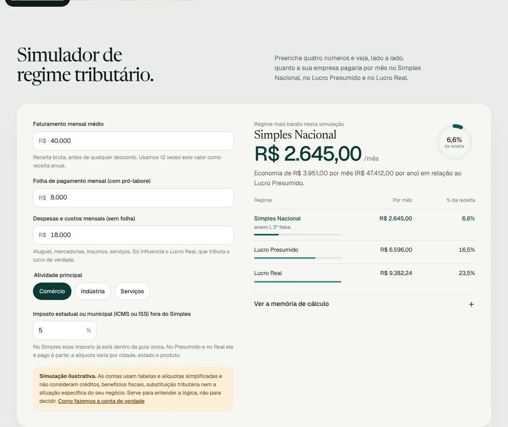
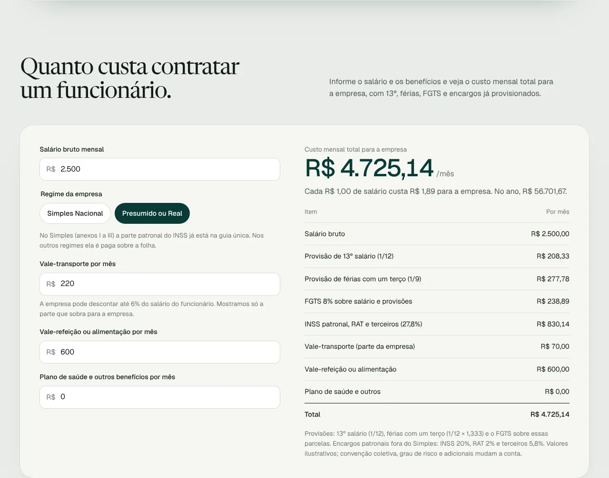
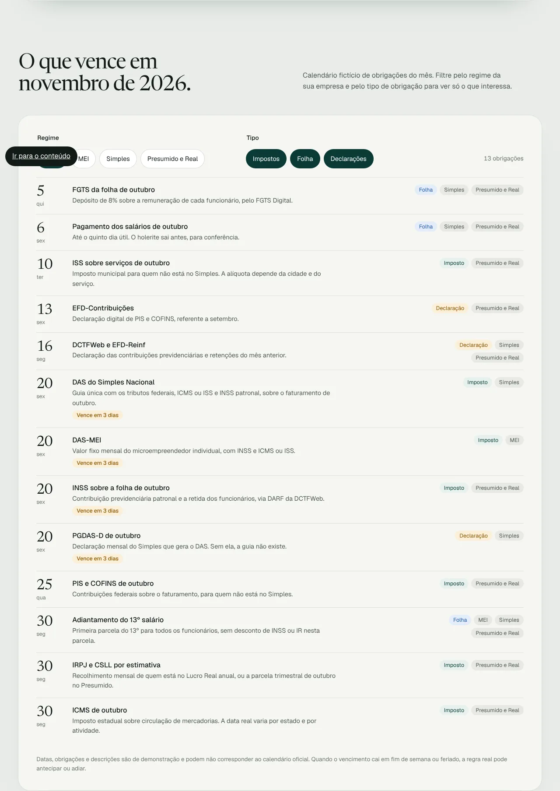
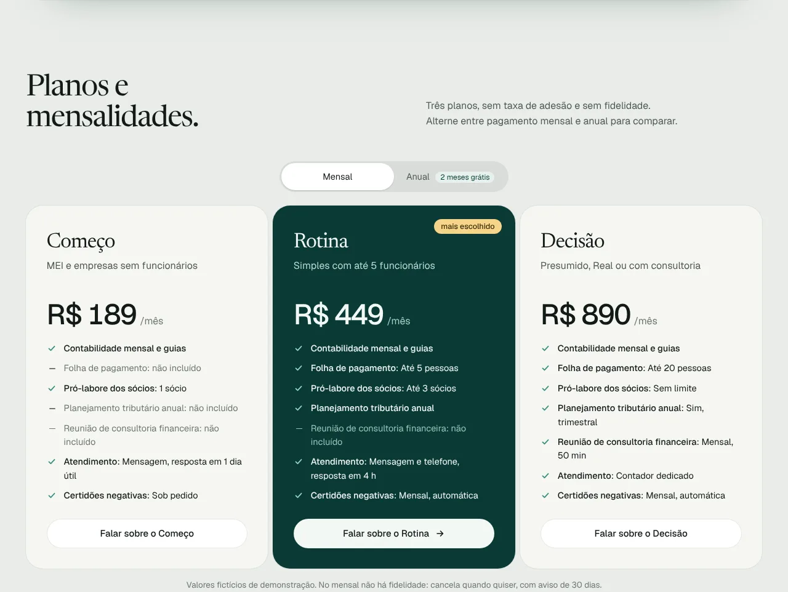

# Lastro Contabilidade

Site de demonstração que eu, Rodrigo Jr, da [Mil e Uma Linhas!](https://mileumalinhas.com.br), fiz para mostrar como pode ser o site de um escritório de contabilidade e consultoria financeira para pequenas empresas.

Endereço: https://toshiro01001.github.io/contabilidade/


## O que é este site, para quem não é da área

É a vitrine de um escritório contábil que não existe, a "Lastro Contabilidade". Ele mostra os serviços, quem seria a equipe, os planos e o jeito de falar com o escritório. E tem quatro ferramentas que funcionam de verdade na sua tela:

1. **Simulador de regime tributário**: você digita faturamento, folha de pagamento, despesas e a atividade da empresa e vê, lado a lado, quanto pagaria por mês no Simples Nacional, no Lucro Presumido e no Lucro Real, com a memória de cálculo aberta para conferir.
2. **Custo de contratar um funcionário**: salário mais 13º, férias, FGTS, encargos e benefícios, com o custo total para a empresa e quanto cada real de salário custa de verdade.
3. **O que vence no mês**: um calendário de obrigações com filtros por regime (MEI, Simples, Presumido e Real) e por tipo (impostos, folha, declarações).
4. **Planos e mensalidades**: tabela comparativa que alterna entre pagamento mensal e anual.

O formulário de contato confere o que você digitou e mostra um resumo na tela, sem enviar nada para ninguém.

No topo da página há ainda um painel de exemplo, o "Portal do cliente", que mostra a mesma conta do simulador para uma empresa inventada.

## Aviso: tudo é fictício

Empresa, pessoas, CRC, endereço, telefone, depoimentos, preços e datas do calendário são inventados. As contas do simulador e da calculadora são simplificadas e servem para entender a lógica, não para decidir. Nada é vendido, cobrado ou enviado.

## Como usar

1. Abra o endereço acima no computador ou no celular.
2. No painel do topo, arraste o "Faturamento mensal" e troque a atividade: os três valores mudam na hora.
3. Role até "Simulador de regime tributário", mude os números e veja o resultado trocar na hora. Abra "Ver a memória de cálculo" para entender cada parcela.
4. Em "Quanto custa contratar um funcionário", digite o salário e os benefícios e troque o regime da empresa para ver a diferença dos encargos.
5. Em "O que vence em novembro de 2026", toque nos filtros para ver só as obrigações do seu regime ou tipo.
6. Em "Planos e mensalidades", alterne entre Mensal e Anual.
7. Em "Fale com a gente", preencha o formulário e clique em "Conferir e ver o resumo". O botão faz uma varredura de pouco mais de um segundo, muda para "Resumo pronto" e o resumo aparece ao lado. Nada é enviado.


## Identidade visual, em resumo

Em 17/11/2026 o site foi refeito no Padrão Premium da Mil e Uma Linhas!, a partir do modelo Prado do ProfitizeBuild. A ideia é a **manhã no escritório**: papel claro, verde-petróleo e um título em serifa, com o painel do cliente aparecendo de trás de colinas.

- **Primeira tela**: o painel "Portal do cliente" mostra a conta do mês da empresa de exemplo (Simples, Presumido e Real lado a lado). Ele é o mesmo simulador da seção de baixo: arrastar o faturamento no topo muda os dois. As colinas cobrem metade do painel e descem conforme a página rola.
- **Colinas vivas**: o relevo das colinas é desenhado em WebGL, com curvas de nível que se movem devagar e levantam um morro onde o ponteiro passa (componente Topografia, do ProfitizeBuild). Sem WebGL, em aparelho lento ou com "reduzir movimento", as colinas ficam paradas.
- **Paleta**: Página `#E9ECE8`, Papel `#F6F6F2`, Tinta `#111A17`, Petróleo `#0E5B55` (o destaque), Petróleo escuro `#0A3A36`, Âmbar `#8A5708` (avisos e prazos próximos) e Ferrugem `#A63B2A` (só para valores negativos e erros).
- **Fontes**: Newsreader (serifa, nos títulos e nomes), Geist (texto, interface e números, sempre com algarismos alinhados) e Geist Mono (só na etiqueta do topo). As três são de licença aberta (SIL OFL) e vão dentro do próprio site, sem Google Fonts nem CDN.
- **Fotos** (todas geradas por IA no Canva, ilustrativas; equipe, loja e escritório não existem): `img/hero.webp`, `img/cracha-folha-pagamento.webp` e `img/calendario-mesa-clipes.webp` nos três cartões, `img/mesa-fechamento-pastas.webp` nos serviços, `img/equipe-escritorio-janela.webp` na equipe e `img/recepcao-escritorio.webp` no fecho. Para o site de um escritório real, é preciso fazer fotos do próprio escritório.
- **Movimento**: rolagem suave, títulos que sobem por linha, cartões que entram em sequência, e números que contam. Nada prende a rolagem. Quem pede menos movimento no sistema (`prefers-reduced-motion`) vê tudo pronto, sem animação.
- **Assinatura**: o rodapé de vidro leva a assinatura M1L! | RTJ.

O estudo completo está em [`docs/identidade.md`](docs/identidade.md).

## Capturas das funções

| Simulador de regime | Custo de funcionário |
|---|---|
|  |  |

| Calendário de prazos | Planos |
|---|---|
|  |  |

## Como funciona por dentro

Tudo acontece no seu navegador. Quando você muda um número, o programa refaz a conta na hora, usando tabelas de alíquotas gravadas no próprio site, e redesenha o resultado. O painel do topo, os três cartões e o simulador usam a mesma conta. O calendário é uma lista gravada no site, e os filtros só escondem e mostram linhas. Não existe servidor, banco de dados nem cadastro: fechou a página, tudo volta ao começo.

## Onde está cada coisa

- `index.html`: a página. Ela carrega um arquivo de programa e uma folha de estilo de `assets/` (os nomes mudam a cada compilação).
- `assets/`: o programa compilado (React), o estilo e as fontes.
- `img/`: as fotos, as máscaras das colinas e a assinatura.
- `404.html`, `404.css` e `fonts/newsreader.woff2`: a página de erro, que não usa script.
- `licencas/`: as licenças do React, do Lenis e das três fontes.
- `tests/site.cjs`: os testes.
- `docs/`: capturas, identidade e vistoria de segurança.

O código-fonte (React) fica no repositório privado `mil-e-uma-linhas-conteudo`, em `vitrines-fonte/lastro-prado/`. Lá, `node publicar.mjs` compila e copia a página pronta para este repositório. Os arquivos de `assets/` são compilados: não edite à mão.

## Detalhes técnicos

- React 18 e Lenis (rolagem suave), compilados com Vite. Sem CDN, sem analytics, sem fonte externa.
- WebGL2 puro, sem biblioteca, no relevo das colinas. Meia resolução, pausa quando sai da tela e um fiscal de fluidez que congela o relevo se o aparelho não acompanhar.
- Content-Security-Policy por meta: `default-src 'self'`, sem script inline, `connect-src 'none'`, `form-action 'none'`. Posições e larguras dinâmicas são aplicadas pelo programa direto no elemento, o que a CSP permite.
- Simulador: Simples Nacional com as seis faixas dos anexos I, II, III e V, Fator R para serviços (folha dividida pela receita, 28%) e alíquota efetiva `(RBT12 × nominal − dedução) ÷ RBT12`. Presumido com presunção de 8% ou 32% para IRPJ e 12% ou 32% para CSLL, adicional de IRPJ sobre o que passa de R$ 20 mil por mês, PIS 0,65%, COFINS 3%, encargos patronais de 27,8% da folha e ICMS ou ISS informado. Real com IRPJ e CSLL sobre o lucro informado, PIS 1,65% e COFINS 7,6% sem créditos. Acima de R$ 4,8 milhões por ano o Simples sai da comparação.
- Calculadora: 13º (1/12), férias com um terço (1/9), FGTS 8% sobre salário e provisões, encargos patronais de 27,8% fora do Simples, vale-transporte descontando 6% do salário.
- Acessibilidade: foco visível, rótulos em todos os campos, resultados em `aria-live`, navegação por teclado, link "Ir para o conteúdo", `prefers-reduced-motion`.
- Arquivos para publicação: `404.html` com caminhos absolutos em `/contabilidade/`, `robots.txt`, `sitemap.xml` e o arquivo de verificação do Google.

## Como rodar no seu computador

```
python3 -m http.server 8303
```

Depois abra http://localhost:8303/ no navegador. Qualquer servidor de arquivos estáticos serve; abrir o arquivo direto do disco não funciona por causa das fontes e da CSP.

## Testes

Com o site servido na porta 8303 e o Playwright instalado (`npm i playwright`):

```
node tests/site.cjs
```

O script abre o site em três tamanhos (1280×900, iPhone 13 e 320px) e confere: nenhum erro de console, nenhuma rolagem horizontal, nenhum texto cortado, fontes locais carregadas, o painel do topo e o relevo das colinas, a ligação entre o painel e o simulador, o menu do celular, as quatro funções com valores esperados (por exemplo, Simples comércio com R$ 40 mil de faturamento dá R$ 2.645,00), o estado "conferindo" e o "Resumo pronto" do botão de contato e que o formulário não faz nenhuma requisição externa. No fim, confere a página com movimento reduzido e sem JavaScript. Com `CAPTURAS=1` ele também salva as imagens em `docs/`.

## Segurança

Nenhum dado sai do navegador, nada fica guardado (sem `localStorage`, sem cookies), nenhum dado real no repositório. As bibliotecas (React e Lenis) vão compiladas dentro do próprio site. A vistoria está em [`docs/vistoria.md`](docs/vistoria.md).

## Quer um site assim para o seu escritório?

Esta é uma das demonstrações da [Mil e Uma Linhas!](https://mileumalinhas.com.br). Eu faço sites e sistemas para quem quer ser entendido pelo cliente.
